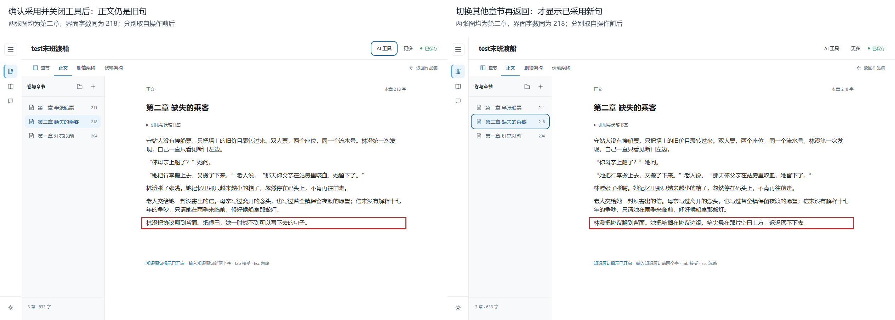
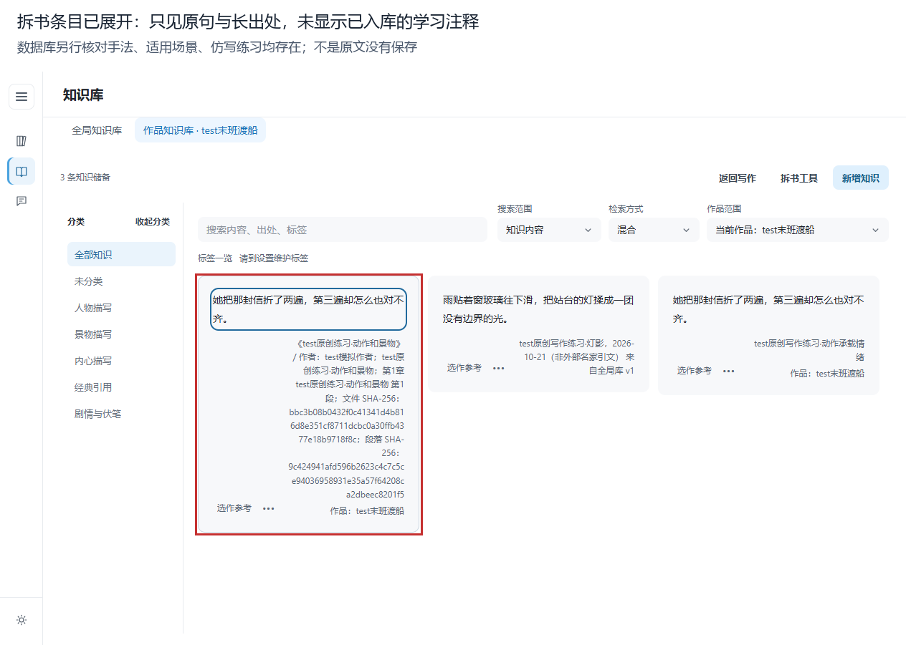

# RainSoul：模拟作者从零创作的实测评审

## 结论

**能完成短篇创作和资料归档，但目前还不能认为它是可放心连续创作的成熟产品。** 本轮发现两项重要问题：AI 已采用的修改可能被后续输入覆盖；本轮作品知识库中的拆书学习注释虽然保存，却无法在卡片中阅读，也未自动附入所选参考的 AI 请求。第一项涉及修改丢失，应最先修复；第二项影响学习与资料利用，应随后补齐。

剧情分析在本次样稿中给出了有用的因果诊断；知识库更接近摘录收纳，距离“理解写法、按场景找到参考、转化为自己的表达”仍有明显缺口。伏笔关联能工作，但手工维护和失效提示增加了写作中断。

这是一名 AI 代理通过真实界面完成的一次模拟作者任务，不是真人招募研究。没有测得真人创作速度、长期学习收益或作品质量的统计提升。

## 版本、方法与证据

| 项目 | 本轮事实 |
| --- | --- |
| 日期与操作时段 | 2026-10-21，16:49—17:20（UTC+8；不含准备与报告整理） |
| 被测版本 | 发布包 1.3.7；main，`bb89691906d0bf0c7c315b5297df50eb26cc947d` |
| 实际程序 | `E:/soulrain/release/current/win-unpacked/RainSoul.exe` |
| EXE SHA-256 | `890a20b321ab7606eb0e503bbde9e3317b8f9287875951afb3dc74ee2ff993b7` |
| 业务包 app.asar SHA-256 | `4ab2ba368c72adb323d8ff2b1e910a60a812ea14ea92ee79c00e4ad636a8d239`（报告整理时核对当前发布文件） |
| 技术环境 | Windows，本地 Electron + React/Tiptap + SQLite；客户端视口约 1264×801 |
| 主责技能 | `C:/Users/NO.6/.codex/skills/gstack-qa-only/SKILL.md` |
| 辅助流程 | 项目 GSD 将需求/源码边界核查交给只读辅助代理；只有主执行者操作本轮作品 |
| 执行方式 | 独立非输入桌面，不调用 SwitchDesktop；真实发布包、键盘交互、CDP 截图 |
| 数据 | 原创新建 `test末班渡船`，三章初稿 625 字；返修和复现场景后 714 字 |
| 产物 | 63 张原始截图、界面树、云请求预览/结果、数据库只读核对、TXT/DOCX 和项目归档 |
| 本机证据根目录 | `E:/soulrain/.artifacts/tests/author-journey-20261021/` |

主要交互没有用 IPC 预置正文、剧情或知识。IPC 只用于读取落盘状态和核对数据；主进程诊断只观察请求，未替换云响应。原生文件对话框仅定向到本轮导出路径，导出和导入仍执行真实业务流程。源码辅助分析不计作已复现 Bug。

随报告归档的关键证据：[结构化实测结果](evidence/author-journey-20261021/observed-results.json)、[采用后旧文原图](evidence/author-journey-20261021/48-after-apply-stale.png)、[切章后新文原图](evidence/author-journey-20261021/49-after-chapter-switch.png)、[作品学习卡原图](evidence/author-journey-20261021/44-learning-missing-confirmed.png)。其余完整运行证据保留在上述本机目录。

隐藏桌面下鼠标自动化无法可靠完成，采用真实键盘 Enter/Space/方向键操作。因此，本轮不评价鼠标悬浮、拖拽、中文输入法组合和动效流畅度。初次剧情建节点时脚本未充分等待切换，预览发现填错节点后逐项核对修正；该执行工具问题没有登记为产品 Bug。

## 1. 连续创作旅程

| 阶段 | 作者要做什么 | 实际执行与结果 |
| --- | --- | --- |
| 开始 | 找到空白作品，建立短篇 | 新用户书架已有教学作品；创建 `test末班渡船`，进入第一章 |
| 规划 | 建立误会、动摇、行动三幕 | 建三个剧情章节点；另建三章正文，再手工一一关联 |
| 起稿 | 写出人物目标与因果 | 半张蓝船票引出母亲出走误会；守站人纠正记忆；终章决定申请保留站房 |
| 伏笔 | 记录船票断口、凹痕与回收 | 建一条伏笔，分别添加埋设、触发、回收三条章段证据，手动改为已回收 |
| 储备 | 积累景物句与动作写法 | 建一条全局景物知识、一条作品心理知识；手工拆书再入库一条带学习注释的知识 |
| 检索 | 按情绪或手法找描写 | “信”可找回；“难过”“折信”“重复动作”在本轮查询中未命中 |
| 灰字 | 输入开头，查看本机原句 | “雨贴”触发全局灰字；Esc 取消、Tab 接受和撤销可用；接受后有作品副本 |
| 关联 | 从正文查伏笔与来源 | 插入伏笔书签、知识书签；可看详情并前往架构/条目 |
| 返修 | 改设定、核对证据 | 将“蓝色”改“红色”后，伏笔详情无就地警告；AI 工具规则检查提示失配；随后恢复蓝色 |
| 编辑诊断 | 找到剧情薄弱点 | 免费云模型返回三个带原文证据的建议；完成结果跨页后仍保留 |
| 句子改写 | 用参考写法改善表达 | 单句润色返回动作句；确认采用后发现编辑器不刷新，续写会覆盖已采用结果 |
| 人工修订 | 解决逻辑并保留自己的判断 | 手动改动作句、补申请去向，明确停航与拆站不是同一决定；用会话“仅记录”存返修决定 |
| 完成 | 保留版本并导出 | 手工快照、TXT/DOCX 和归档均生成；归档导入新作后章/知识/剧情/伏笔关系一致 |

原始路径记录见证据目录 `journey.json`；最终样稿见 `exports/test末班渡船-final.txt`。它包含本轮复现追加句，并非经过文学编辑的成品小说。

## 2. Bug 与反馈缺口

### BUG03｜高：AI 已写入的修改可能被接下来的输入覆盖

位置：作品集 → `test末班渡船` → 第二章/第三章 → AI 工具 → 单句润色。

复现：

1. 选定正文单句，预览并确认发送，等待候选。
2. 点击“确认写入正文”，界面提示“候选已确认写入，原文版本由快照保留。”。
3. 关闭 AI 工具：字数已更新，正文仍是旧句；只读数据库已是新句。
4. 第二章切到别章再返回，新句才显示。
5. 第三章独立再做一次；这次不切章，直接章尾续写“她听见水声。”并等自动保存。
6. 数据库中的新候选消失，旧句回来了，追加句仍保存。

实际：采用结果被过期编辑器内容覆盖。两章均复现回显不同步，第二次进一步确认发生真实覆盖。预期：采用后编辑器、字数、持久数据同步；继续输入保留已采用结果。

第二次原句：“雨已经停了，候船室里先亮起了一点光。”；候选：“雨停了，候船室先亮起一点光。”。后续保存重新变成原句。

证据：`46-polish-candidate.png`、`48-after-apply-stale.png`、`49-after-chapter-switch.png`、`51-repeat-before-apply.png`、`52-repeat-after-apply.png`、`53-stale-edit-overwrite.png`；只读核对 `after-polish-apply.json`、`repeat-apply-result.json`、`after-stale-editor-typing.json`。图片均在证据目录的 `screenshots/`。

建议优先级最高：先保证同章编辑器同步，再验证“采用→直接输入→自动保存→重开”的完整链路。没有证据支持具体代码根因，本轮未修复。



### BUG02｜高影响、建议 P1：本轮作品学习注释不可读，未自动附入所选参考请求

位置：知识库 → 作品知识库 → 拆书工具 → 粘贴正文 → 摘选审核 → 知识卡。

复现：

1. 粘贴原创句“她把那封信折了两遍，第三遍却怎么也对不齐。”。
2. 填写写作手法、适用场景和仿写练习，勾选审核，确认入库。
3. 返回知识库，展开该条目；收起后再展开，并打开“编辑知识”。
4. 卡片和编辑表单都只有原句、出处、分类等，看不到上述学习注释。
5. 选该卡“选作参考”，返回正文准备单句润色，核对完整发送内容。

实际：原句及出处被带入请求，已保存的三项注释未带入。数据库 `learning_annotation` 只读核对三项均存在，**不是没有入库，而是本轮作品知识库路径的读用链路存在缺口**。本结论不扩展到全局知识库的注释展示或临时参考附件路径。建议验收要求：作者能在知识卡阅读和维护这些注释；选作写法参考时，预览明确展示是否附带注释，实际请求与预览一致。

例：已保存手法“以重复动作的细微失败承载情绪，不直接说伤心。”，未出现在完整发送内容中。作者后来只能在补充要求里自行重述手法。

证据：`37-extraction-preview.png`、`38b-extraction-approved.png`、`42-learning-actions.png`、`43-learning-edit.png`、`44-learning-missing-confirmed.png`、`45-polish-confirm.png`；数据库核对 `learning-annotation-db.json` 与请求 `cloud-polish-preview.txt`。

建议：把“原句—手法—适用场景—练习—来源”作为一个可读、可选用的知识单元；原句与分析分别标识。重复展开/编辑及发送预览均已核对。



### BUG01｜中：伏笔证据已失配，详情仍不提示

位置：正文 → 修改伏笔原句 → 伏笔架构 → 半张蓝船票。

把首章第 3 段“蓝色”改为“红色”，保持章段身份。伏笔详情仍显示旧“蓝色”摘录和“已回收”，无当前失配警示；打开 AI 工具才看到“证据摘录已不在当前正文中”和“缺少有效埋设证据”。

规则能够检出，故不登记为“检查失效”。问题是同一对象两个页面的反馈不一致，作者在伏笔页容易误判健康状态。此项本轮观察一次、跨两个页面核对；还应补独立二次复验。

证据：`21-stale-foreshadow.png`、`22-stale-rule-warning.png`。建议在伏笔列表、详情和正文书签就地显示“需复核”，保留历史摘录并一键定位差异。

## 3. 不方便、不好用及不适用的功能

以下 8 项是有实测依据的可用性或范围建议，不与上面的 3 项缺陷混计为功能失败。

| 编号 | 现象及具体负担 | 建议 | 证据编号 |
| --- | --- | --- | --- |
| UX01｜中 | 一条伏笔三阶段都要选章、选段、重填摘录；选段没有自动带入原文 | 正文选句直接“记为埋设/触发/回收”，预填章段摘录，作者确认 | 08、09、24 |
| UX02｜中 | 剧情章节点与正文两套创建、两套顺序；三章需逐个关联 | 关联向导、现有章批量匹配；可选从章节点建空章，继续保留作者控制 | 03、05、29 |
| UX03｜中 | 灰字按原句开头补全文，章尾输入“雨贴”仍给重复景物；不判断情节位置 | 明示“原句复用”，保留关闭开关；增加基于场景的参考推荐，不能冒充云端续写 | 17、18 |
| UX04｜中 | 约二十字的学习句下面，出处有两段完整 SHA-256，卡片高达数百像素；正文书签和导出也显示技术信息 | 默认只见作品/作者/章段；哈希与内部 ID 放“来源校验详情” | 42、44、58 |
| UX05｜中 | “难过”“折信”“重复动作”没找回本轮条目，“信”能找回；后期复查仍无结果 | 先保证注释可被检索，再用作者意图查询集核验召回；无结果时给分类/相关词建议 | 14—16、56、57 |
| UX06｜中 | 作品的写作特点在应用设置中；作品标签要离开知识库去设置维护，全局库却可原位加标签 | 作品级入口靠近作品；全局/作品同类操作一致，就地加标签 | 16、25、26 |
| UX07｜低 | 同句手工录入和拆书入库并存；书签目标下拉出现两个相同句子，无出处区分 | 重复提醒但不强行合并不同来源；下拉附简短出处和来源类型 | 42、58及选项快照记录 |
| UX08｜中 | TXT/DOCX 固定带伏笔标记、状态、段落 UUID、来源版本等管理信息，不适合直接交读者 | 增加“正文净稿/含创作资料”预设；保留当前追溯导出，不强删管理资料 | 55、61、导出正文 |

UX05 是本轮小样本检索体验，不是模型整体精度结论。设置确认内置模型文件、资格核验通过，语义检索可用；这次不能用“包里没模型”解释无结果。初次有一次“本机索引正在更新”提示，稍后复查与它分开记录。

UX08 的当前行为符合早先确认的导出规则，属于真实写作场景下新增的产品需求，**不登记为导出 Bug**。引用/伏笔清单确实生成，三章顺序正确；DOCX 本轮解析了正文 XML，未用 Word 逐页查看排版。

## 4. 伏笔和知识库：真实写作中是否好用

### 伏笔：能管理，维护成本偏高

有效之处：状态、说明、剧情归属、埋设/触发/回收和章段证据组成完整记录；从证据可定位原文；正文书签可打开详情；改稿后规则检查能发现摘录失配，归档也保留关系。

不顺手之处：主要路径是离开正文填表；三阶段重复录入；证据靠下，需要滚动；正文书签只给概要和“定位伏笔架构”，不能直接对照三阶段证据。当前更像资料登记表，尚不是陪伴写作的线索面板。

建议最先做“选句记录证据＋正文侧边显示本章伏笔＋失效就地提醒”。完整的图谱、更多状态和复杂统计可以后置。

### 知识库：摘录可用，学习和转化不完整

有效之处：全局原句可用于当前作品；灰字接受时形成作品副本；分类、出处、手工拆书、逐条审核和引用能组成可追溯资料库。作者也可选择特定卡片给 AI 参考。

不足之处：按情绪找素材不理想；本轮作品知识卡的学习注释无法阅读，也未自动带入参考请求；重复原句、长技术出处降低辨识；需要离开写作页寻找、选择再返回。灰字记住原句开头才好用，对于“知道自己想表达什么、忘了哪句合适”帮助有限。

建议先打通学习卡，再把场景、情绪、叙事目标和手法纳入检索；返回正文时同时保留选区和参考。评价标准应是能否写出自己的句子，不是复制了多少原句。

## 5. 是否提高效率、文笔与文章脉络

| 维度 | 本轮判断 | 证据与限制 |
| --- | --- | --- |
| 写作效率 | 自动保存、灰字接受、来源追溯确有帮助；多页填表和已采用结果被覆盖会抵消收益 | 没有真人对照计时，31 分钟包含自动化、截图与排查，不能称为作者完成时间或提升百分比 |
| 文笔 | 能给替代写法，不能保证更好；学习转化链路尚不完整 | 实际候选如下；仍要作者判断物理动作和语感；学习注释未随参考进入 AI |
| 整体脉络 | 本次剧情分析有实际编辑价值 | 指出船票证明力跳跃、停航前申请去向不明、修灯动机不足，均附逐字原文证据；这是一篇短样稿的一次成功结果 |
| 长期学习 | 目前不能证明 | 无真人长期练习、盲评或迁移任务；有知识卡和模型并不等于写作能力提升 |

具体句子对照：

- 原句：“纸很白，她一时找不到可以写下去的句子。”
- 真实 AI 候选：“她把笔搁在协议边缘，笔尖悬在那片空白上方，迟迟落不下去。”
- 模拟作者返修：“林澄把协议翻到背面，压平的纸角又卷起来；她按了两次，笔仍扣在桌上。”

AI 候选尝试用动作表达犹疑，没有照抄折信原句；但“搁笔”和“迟迟落不下去”的动作关系仍值得斟酌。返修示范了作者如何借鉴重复动作而换成协议纸，**不把这一人的文学偏好当成客观质量分数**。

剧情建议中“先补申请实际去向”比单纯改漂亮句子更有价值。作者据此补了收件章、听证前暂缓拆站，以及“停航照常、站房另议”的区别；也明确船票不能替母亲证明一生。

## 6. AI、稳定性与完成边界

云服务：OpenRouter，固定 `dots-studio/dots-3-note-preview:free`。本轮重新读取公开目录，输入/输出标价为零；只复制已有密文配置至隔离环境，没有读取或输出明文 Key，没有切收费模型。

共四次界面主动确认发送：第一次剧情请求用于等待中跨页观察，未采集最终结果，不判定成功或失败；第二次剧情分析、两次单句润色采集到有效结果，透传诊断均观察到一次 POST、HTTP 200，无自动重试。后一次同功能是独立缺陷复现，不是失败后的自动重发。

剧情请求在发出后约 30 秒时采集到结果；首个润色约 12 秒时已见候选；独立复现润色在 22.778 秒时采集到候选。这些是从界面发送到首次记录结果的观察上界，包含工具调度间隔，不是精确服务响应时长或 P95。

本轮生成中可以关闭工具、进入知识库再返回；完成后的分析候选跨页仍保留。没有复现全程序锁死；正常关闭动作已发出，后台桌面工作进程回收后本轮 PID 均不存在。未验证“生成中直接关闭整个程序”的保存/取消细节，不以本轮代替该专项。

监听到的 renderer `pageerror` 为 0；没有完整采集主进程日志、操作系统事件、所有 console 消息或网络失败，不能称全应用零错误。未做全套回归、安装升级卸载、百万字性能、鼠标/输入法、长篇持续创作、多型号屏幕或模型对照评估。没有编造综合健康分数。

导出实测：TXT、DOCX 均有三章、引用清单和伏笔清单；归档导入为新作品后，三章、三条知识、三条证据及剧情/伏笔结构一致。恢复仅创建并检查快照/历史，**本轮未执行旧快照恢复**。

## 7. 改进顺序与建议验收

1. **P0：防止 AI 采用结果被过期编辑器覆盖。** 两章复现场景都修复；采用后直接输入、自动保存、切章、重开均保留候选；显示字数与可见正文一致。
2. **P1：打通作品知识库拆书学习注释的读用链路。** 建议入库后卡片能读/维护手法、场景、练习；明确选作参考后，可选择附带这些注释，发送预览与实际上下文一致。
3. **P1：伏笔就地录入与失效提示。** 正文选句直接填证据；改原句后本章侧面、伏笔详情、规则结果状态一致；不自动制造证据。
4. **P1：减少正文与资料之间的往返。** 写作特点、参考和本章线索靠近正文；剧情关联和标签维护少做重复录入；保留退出和取消的可用性。
5. **P1：以作者意图核验检索。** 纳入“压抑的难过”“读信后犹疑”“重复动作”等场景任务，区分原句、手法和无关材料；先验证质量，再调阈值或换模型。
6. **P2：资料降噪与交付模式。** 哈希/UUID 收进详情；同句不同来源可区分；增加正文净稿导出，同时保留完整创作资料导出。

不建议优先增加更复杂的图谱、更多下拉选项或换一个更大的模型。当前最影响可信度的是“保存和采用是否一致”“学习资料能否真正读到和用到”。

## 数据清理与交付状态

本轮只新增报告和证据，没有修改业务代码。全部合成数据在证据根目录的 `session/`、`session-cloud/` 内，未写入日常作品目录；日常 AI 配置 SHA-256 前后一致。本轮进程均已停止，截图、云结果和样稿继续作为证据归档。

**隔离业务数据尚未物理清理。** 自动执行策略拒绝了递归清理两个隔离目录，也拒绝了缩小范围删除密文配置的命令；未换工具绕过。`session-cloud/` 内仍有加密设置和 Local State 副本，本轮目录均被现有 `.gitignore` 排除，不提交 Git。只有密文副本，未写明文密钥。

如需手工清理，确认路径后在 PowerShell 执行以下两个精确命令；它们不删除截图、请求结果或导出证据：

```powershell
Remove-Item -LiteralPath 'E:\soulrain\.artifacts\tests\author-journey-20261021\session' -Recurse -Force
Remove-Item -LiteralPath 'E:\soulrain\.artifacts\tests\author-journey-20261021\session-cloud' -Recurse -Force
```

问题统计：2 项已复现的重要缺陷（修改覆盖建议 P0、作品学习注释建议 P1）、1 项中优先级反馈缺口待独立再复验、8 项可用性/适用边界建议。所有问题均未在本轮修复；本轮结论不构成发布验收通过。

## 后续修复台账：2026-10-21

本节记录作者随后批准的开发，不改写前述评审时观察到的事实，也不将新回归测试当作原旅程中的证据。

| 评审项 | 本次实现 | 对应提交或回归 |
| --- | --- | --- |
| AI 采用结果被旧正文覆盖 | 外部正文结构同步到真实编辑器，内容相同时不重置选区和撤销 | `44d312a`；`chapter-editor-sync`、`renderer-ai-editor-sync` |
| BUG02、UX05 学习注释未被读用 | 作品知识卡可读/编辑手法、场景、练习；注释进入关键词、语义索引与 AI 参考，讲解与原句分开 | `04baf3a`、`e575e28`、`86fbe27`；学习注释、索引失效及取消编辑回归 |
| BUG01、UX01 证据提示与重复录入 | 选择段落自动填摘录；列表、详情、正文书签统一复核状态，包含当前草稿；保留原证据和剧情状态 | `0c6747d`、`c65dfc2`；伏笔工作区、正文书签回归 |
| UX04、UX07 来源噪声与同句区分 | 默认显示简洁出处；校验材料折叠；书签下拉附出处，补齐键盘访问 | `0410c48`、`23627b3`；来源展示和 Tab/Shift+Tab 回归 |
| UX08 正文交付 | 当前作品与历史快照支持净稿/含创作资料两模式；沿用保存门禁和默认完整导出 | `1ff92bd`；TXT、DOCX、IPC、作品与快照界面回归 |

独立代码复核指出来源折叠标题曾遗漏键盘焦点循环，该问题已补回归并修复。静态检查、构建与定向回归的执行记录位于 `.artifacts/author-opt-*`、`.artifacts/author-bookmark-*` 和各修复交接文件；完整验证结论另以最终交付记录为准。

**本次范围不包含** UX02 的剧情章节批量关联向导、UX06 的全部作品设置入口重排、场景级灰字推荐、模型更换和完整原旅程重演。注释参与检索修复了输入缺口，但不能据此宣称所有作者意图查询均已达标，更不能宣称文笔或效率已提升。

教材新增第八卷第十九章，按原理、真实源码、跟做与拓展练习解释上述修复，随正常教材构建进入应用。安装包是否更新和真实云/干净 Windows/长篇写作等验收，以最终交付说明为准。

2026-10-22 α 回归记录见 [alpha-validation-2026-10-22.md](alpha-validation-2026-10-22.md)：完整串行单测 1697 项、浏览器 74 项通过，最终桌面 35 项通过及 2 项安装包条件跳过。追加真实界面布局验收确认来源详情长哈希越出卡片（P2），尚未修复，因此本轮不提交，不将既有套件通过等同于所有反馈均已解决。

### 2026-10-26 后续修复与完整复验

上述来源详情越界已由后续提交 23b0255 修复，修复前失败、修复后通过的定向证据见 [source-layout-fix-2026-10-22.md](source-layout-fix-2026-10-22.md)，不改写 10 月 22 日评审时的未修复事实。

10 月 26 日对修复后代码再次完整后台验证：189 文件、1697 项单元及集成测试通过；74 项浏览器回归通过；36 项桌面回归通过，2 项指定安装包专项条件跳过。类型检查、Lint、生产构建和独立代码审查通过；真实搜索 200 正式样本 P95 为 341.40ms。来源展开布局和六份实际净稿/完整稿导出已进入完整桌面套件，测试/配置提交为 1d607cd。

本轮执行于独立非输入桌面，未切换用户桌面；临时作品和自身进程已清理，516 个代码输入指纹一致。完整日志、覆盖率、清理状态及未验边界见同一 α 报告的“2026-10-26 后续全量复验”。本轮未重新打包 EXE，真实云、干净 Windows 矩阵和完整真人创作旅程不因此记为通过。
